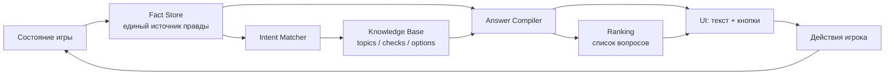
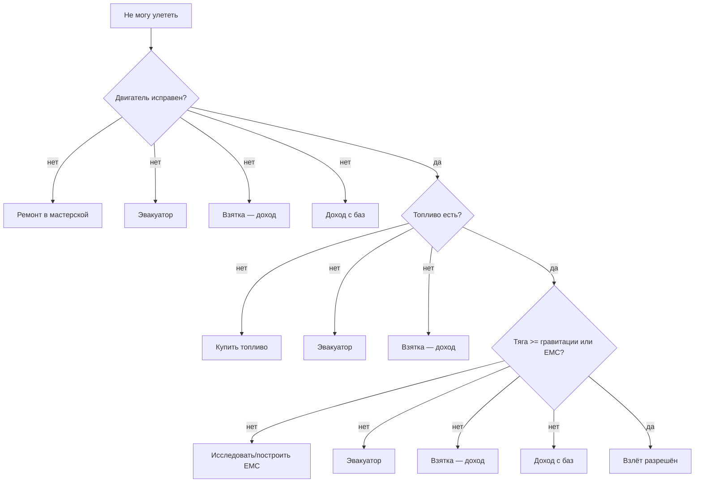
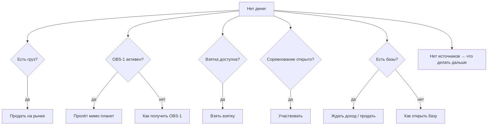

# Концепция H-helper — помощник капитана

**TL;DR:** H — не FAQ и не квест-лог. Это «объяснитель состояния»: он читает факты игры, находит причину проблемы, собирает ответ из шаблонов и предлагает действия. Дерево ответов — это граф контента (тема → проверки → опции), а не статичный текст. В диалоге игрок видит один узел за раз, а система сама решает, какие ветки показать.

---

## 1. Принципы

| Принцип | Что значит |
|---|---|
| H не хранит ответы | Он хранит правила: факты, условия, опции. Текст собирается в момент вопроса. |
| Одна тема = одна цель игрока | «Улететь», «заработать», «починить», «понять, что дальше». |
| Сначала действие | Первая строка ответа — что делать. «Почему» — по запросу. |
| Никаких выдумок | Каждое утверждение ссылается на факт. Неизвестно → «не знаю, как проверить». |
| Скрытые опции по запросу | Спойлеры и «пасхалки» не показываются по умолчанию. |
| Дерево — контент, диалог — путь | Не более 2 уровней на экране; глубина раскрывается кликами. |
| Один источник правды | H не хранит своё состояние, а читает состояние игры. |

---

## 2. Архитектура



| Слой | Ответственность |
|---|---|
| **Fact Store** | Единый снимок состояния: деньги, корабль, планета, базы, взятки, OBS-1, соревнования. |
| **Knowledge Base** | Декларативные темы: триггеры, чек-листы, опции, условия, тексты. |
| **Intent Matcher** | Понять вопрос: ключевые слова, синонимы, нечёткое совпадение, мультиинтент. |
| **Answer Compiler** | Собрать ответ: найти первую невыполненную проверку, отфильтровать опции, объяснить блокировки. |
| **Ranking** | Показать 4–6 актуальных вопросов: срочность, контекст, новизна. |
| **UI / Actions** | Карточка ответа, кнопки, подтверждения, переходы в игровые панели. |

H живёт в терминале капитана (база/корабль) — это один помощник с общим состоянием, просто точки входа разные.

---

## 3. Факты: на чём стоит всё

Каждый факт — это `id`, предикат и человекочитаемая причина. Причина нужна, чтобы H мог сказать **«почему опция недоступна»**, не хардкодя текст.

| id | Пример предиката | Label / why |
|---|---|---|
| `ship.engines_ok` | `ship.engine >= 0.5` | «двигатель сломан» |
| `ship.fuel` | `ship.fuel > 0` | «нет топлива» |
| `ship.thrust` | `ship.thrust >= planet.gravity \|\| planet.emc` | «не хватает тяги, EMC не построен» |
| `planet.emc` | `planet.emc == true` | «EMC не построен» |
| `tech.emc` | `tech.emc == true` | «EMC не исследован» |
| `planet.shop` | `planet.shop == true` | «на планете нет мастерской» |
| `planet.market` | `planet.market == true` | «на планете нет рынка» |
| `player.cash` | `cash >= X` | «не хватает N кр.» |
| `player.cargo` | `cargo > 0` | «груза нет» |
| `player.bases` | `bases > 0` | «у тебя нет баз» |
| `planet.bribe` | `bribe_available == true` | «взятка уже взята на этой планете» |
| `evac.available` | `evac.available == true` | «эвакуатор сейчас не ходит» |
| `obs.active` | `obs.active == true` | «OBS-1 не установлен или выключен» |
| `competition.open` | `competition.open == true` | «соревнование закрыто» |
| `quest.current` | всегда | «текущая цель: …» |

**Важно:** «взятка» в вашем примере — это **доход** (взять взятку), а не расход. Она доступна один раз на планете и сбрасывается при посещении другой планеты. Это отдельный факт `planet.bribe` + действие `bribe.take`.

Производные факты (считаются из базовых, не хранятся):

```js
can_afford_repair, can_afford_evac, can_build_emc,
income_sources_count, is_grounded, has_any_base
```

Реестр условий:

```js
const C = {
  engines_ok:        { test: s => s.ship.engine >= 0.5, why: "двигатель сломан" },
  has_fuel:          { test: s => s.ship.fuel > 0, why: "нет топлива" },
  enough_thrust:     { test: s => s.ship.thrust >= s.planet.gravity || s.planet.emc, why: "не хватает тяги, EMC не построен" },
  shop_here:         { test: s => s.planet.shop, why: "на планете нет мастерской" },
  can_afford_repair: { test: s => s.cash >= s.prices.repair, why: s => `не хватает ${s.prices.repair - s.cash} кр.` },
  bribe_available:   { test: s => s.planet.bribe, why: "взятка уже взята на этой планете" },
  has_bases:         { test: s => s.player.bases > 0, why: "у тебя нет баз" },
  obs_active:        { test: s => s.obs.active, why: "OBS-1 не установлен или выключен" },
  competition_open:  { test: s => s.competition.open, why: "соревнование закрыто" }
};
```

Благодаря `why` фраза «но у тебя таких нет» генерируется автоматически: H берёт причину первой невыполненной опции.

---

## 4. Контент: тема = цель + чек-лист + опции

```json
{
  "id": "leave_planet",
  "title": "Не могу улететь",
  "triggers": ["улететь", "взлететь", "покинуть планету", "не могу улететь", "застрял"],
  "urgency": "ship.engines_ok ? 0 : 100",
  "checks": [
    {
      "id": "engines",
      "when": "engines_ok",
      "fail": "Корабль неисправен: {engine}. Ремонт стоит {repair_price} кр., у тебя {cash} кр.",
      "options": ["repair_ship", "evac", "bribe", "wait_base_income"]
    },
    {
      "id": "fuel",
      "when": "has_fuel",
      "fail": "Нет топлива. Нужно {fuel_need} ед., у тебя {fuel}.",
      "options": ["buy_fuel", "evac", "bribe"]
    },
    {
      "id": "mass",
      "when": "enough_thrust",
      "fail": "Планета слишком тяжёлая: EMC не построен, тяги не хватает.",
      "options": ["build_emc", "research_emc", "evac", "bribe", "wait_base_income"]
    }
  ],
  "success": "Все системы в норме — можно взлетать.",
  "followups": ["no_money", "get_base", "bribe_rules"]
}
```

Опции — отдельный справочник:

```json
{
  "repair_ship": {
    "label": "Ремонт в мастерской — {repair_price} кр.",
    "requires": ["shop_here", "can_afford_repair"],
    "action": { "type": "open", "panel": "repair" },
    "blocked": { "shop_here": "find_shop", "can_afford_repair": "no_money" }
  },
  "evac": {
    "label": "Коммерческий эвакуатор — {evac_price} кр.",
    "requires": ["evac_available", "can_afford_evac"],
    "action": { "type": "confirm", "dialog": "evac" },
    "blocked": { "evac_available": "evac_rules", "can_afford_evac": "no_money" }
  },
  "bribe": {
    "label": "Взять взятку — +{bribe_amount} кр.",
    "requires": ["bribe_available"],
    "action": { "type": "confirm", "dialog": "bribe" },
    "blocked": { "bribe_available": "bribe_rules" }
  },
  "wait_base_income": {
    "label": "Дождаться дохода с баз — {base_income} кр.",
    "requires": ["has_bases"],
    "action": { "type": "wait", "until": "base.income.ready" },
    "blocked": { "has_bases": "get_base" }
  }
}
```

Опция может быть **недоступна**, но всё равно показывается — с причиной. Это и есть «но у тебя таких нет».

---

## 5. Компилятор ответа

```js
function compile(topic, s) {
  const check = topic.checks.find(c => !C[c.when].test(s));
  if (!check) {
    return { text: topic.success, open: [], closed: [], followups: topic.followups || [] };
  }

  const options = check.options.map(id => {
    const o = OPTIONS[id];
    const failed = o.requires
      .map(r => ({ id: r, ...C[r] }))
      .find(c => !c.test(s));

    return {
      id,
      label: fill(o.label, s),
      action: o.action,
      blocked: failed ? failed.why(s) : null,
      blockedTopic: failed ? (o.blocked && o.blocked[failed.id]) : null
    };
  });

  return {
    cause: fill(check.fail, s),
    open: options.filter(o => !o.blocked),
    closed: options.filter(o => o.blocked),
    followups: uniq(
      options.map(o => o.blockedTopic).filter(Boolean)
        .concat(topic.followups || [])
    )
  };
}
```

Что делает компилятор:

1. Идёт по чек-листу темы и находит **первую невыполненную проверку** — это корневая причина.
2. Для каждой опции проверяет `requires`; если не выполнено — берёт `why` и `blockedTopic`.
3. Разделяет опции на **доступные** и **заблокированные с причиной**.
4. Собирает follow-up вопросы из заблокированных опций и из темы.
5. Подставляет слоты: цены, количества, названия планет, имена.

Опционально — **взгляд на 1 шаг вперёд**: если опция заблокирована только деньгами, а другая доступная опция даёт деньги, H говорит: «Сначала возьми взятку — потом хватит на эвакуатор». Это маленький планировщик над фактами, не AI.

---

## 6. Пример 1: «не могу улететь»

Состояние:

```js
{
  ship:   { engine: 1, fuel: 10, thrust: 5 },
  planet: { gravity: 9, emc: false, shop: true, bribe: true },
  cash: 0, cargo: 0, bases: 0,
  prices: { repair: 400, evac: 500, emc: 2000, fuel: 100 },
  bribeAmount: 300
}
```

Проход:

- `engines_ok` → true
- `has_fuel` → true
- `enough_thrust` → false → **причина: планета слишком тяжёлая**
- Опции:
  - `build_emc` — закрыта: «не хватает 2000 кр.»
  - `research_emc` — закрыта: «не хватает … кр.»
  - `evac` — закрыта: «не хватает 500 кр.»
  - `bribe` — **открыта**
  - `wait_base_income` — закрыта: «у тебя нет баз»

Карточка ответа:

```text
┌─ H · Капитанский помощник ────────────────────────────┐
│ Планета слишком тяжёлая: EMC не построен, тяги не      │
│ хватает. У тебя 0 кр.                                  │
│                                                        │
│ Можно сделать:                                         │
│  • Взять взятку — +300 кр. Доступна 1 раз на планете.  │
│  • Эвакуатор — 500 кр. Не хватает 500 кр.              │
│  • Построить EMC — 2 000 кр. Не хватает 2 000 кр.      │
│  • Доход с баз — у тебя нет баз.                       │
│                                                        │
│ [Почему?] [Как заработать?] [Что дальше?] [Закрыть]    │
└────────────────────────────────────────────────────────┘
```

После «Взять взятку» ответ **пересобирается**:

```text
Планета слишком тяжёлая… У тебя 300 кр.
• Эвакуатор — 500 кр. Не хватает 200 кр.
• Построить EMC — 2 000 кр. Не хватает 1 700 кр.
• Взятка — уже взята (вернётся на другой планете).
• Доход с баз — у тебя нет баз.
[Как заработать?] [Что дальше?]
```

Это и есть «динамическое дерево»: игрок не читает простыню, а получает один экран, который меняется вместе с состоянием.

---

## 7. Пример 2: «нет денег»

Тема `no_money` — это не причина, а **список источников дохода**, каждый со своим условием:

| Источник | Условие | Действие |
|---|---|---|
| Продать груз | `cargo > 0`, рынок на планете | открыть рынок |
| Пролёт с OBS-1 | `obs.active` | показать маршрут |
| Взятка | `planet.bribe` | взять, 1 раз на планете |
| Соревнование | `competition.open` | участвовать |
| Доход с базы | `bases > 0` | открыть базы / ждать |
| Продажа на базе | `bases > 0`, есть товар | открыть склад |

При `cargo=0, obs=false, bribe=true, competition=true, bases=0`:

```text
┌─ H · Капитанский помощник ────────────────────────────┐
│ Денег нет. Что может принести доход сейчас:            │
│                                                        │
│  • Взятка — +300 кр. Доступна 1 раз на планете.        │
│  • Соревнование — приз 1 500 кр. Приём до 12:00.       │
│  • Продать груз — груза нет.                           │
│  • Пролёт с OBS-1 — OBS-1 не установлен.               │
│  • Доход с базы — у тебя нет баз.                      │
│                                                        │
│ [Взять взятку] [Участвовать] [Как получить OBS-1]      │
│ [Как открыть базу] [Что дальше?]                       │
└────────────────────────────────────────────────────────┘
```

Если **все** источники закрыты, H не выдумывает выход:

```text
Сейчас доступных источников дохода нет.
Ближайший: соревнование откроется через 2 цикла.
[Что делать дальше?] [Почему так?]
```

---

## 8. Дерево ответов (граф контента)

Дерево существует в данных, но игрок идёт по нему по одному узлу.





Ветки, которые не выполняются, не исчезают из контента — они просто не показываются как доступные. При необходимости H может раскрыть их через «показать скрытые варианты».

---

## 9. Типовые вопросы

| # | Вопрос / триггеры | Когда актуален | Что проверяет H | Что предлагает |
|---|---|---|---|---|
| 1 | «не могу улететь», «взлететь», «застрял» | на планете | двигатель, топливо, тяга/EMC | ремонт, топливо, EMC, эвакуатор, взятка, доход с баз |
| 2 | «нет денег», «как заработать» | `cash < порог` | груз, OBS-1, взятка, соревнование, базы | продать, пролёт, взятка, соревнование, база |
| 3 | «корабль сломан», «починить» | `engine < 0.5` | мастерская, цена, деньги | ремонт / эвакуатор / взятка |
| 4 | «где мастерская», «ремонт» | — | `planet.shop`, цены | карта, цена, деньги |
| 5 | «нет топлива», «заправиться» | `fuel <= 0` | цена, деньги, рынок | купить, эвакуатор |
| 6 | «что такое EMC», «построить EMC» | `!planet.emc` | исследование, цена, деньги | исследовать, построить, эвакуатор |
| 7 | «тяжёлая планета», «не хватает тяги» | `thrust < gravity` | EMC, тяга | EMC, эвакуатор |
| 8 | «взятка», «почему один раз» | — | `planet.bribe`, `bribe_used` | взять, правила сброса |
| 9 | «база», «открыть базу», «доход» | — | базы, цена, товар | открыть, список баз, доход |
| 10 | «OBS-1», «наблюдение» | `!obs.active` | цена, слот, маршрут | купить, установить, пролёт |
| 11 | «соревнование», «приз» | `competition.open` | ввод, цена, дедлайн | участвовать, правила |
| 12 | «продать груз», «рынок» | `cargo > 0` | рынок, цены | продать, цена |
| 13 | «куда лететь», «что делать дальше» | — | квест, блокировки | цель, следующий шаг |
| 14 | «почему нельзя купить/построить» | опция закрыта | требования | что не хватает + топик |
| 15 | «репутация» | `rep < порог` | события, штрафы | как поднять |
| 16 | «что нового», «что изменилось» | есть события | diff состояния | список изменений |
| 17 | «управление», «как играть» | — | — | обучение, подсказки |
| 18 | «не помогло» | — | история диалога | другой топик / лог |

Каждая тема — это не текст, а запись в KB. Новый вопрос добавляется данными, а не кодом.

---

## 10. Как формируется список вопросов

При открытии диалога H показывает 4–6 чипов. Оценка темы:

```text
score(topic) =
    3 * intentScore        // насколько точно совпал вопрос
  + 2 * urgency(state)     // блокирует ли игрока прямо сейчас
  + 1 * contextScore       // локация, квест, текущая цель
  + 1 * novelty            // не спрашивал недавно
  - 2 * fatigue            // повторные вопросы
```

- `urgency` задаётся темой: например, `ship.engines_ok ? 0 : 100`.
- Если игрок застрял, чипы «Не могу улететь» и «Нет денег» поднимаются наверх.
- После ответа чипы обновляются: follow-up’ы из заблокированных опций.
- Всегда есть «Что делать дальше?» — мета-тема, которая смотрит на квест и блокировки.
- «Что нового?» строится из diff состояния с прошлого открытия H.

**Свободный текст:** нормализация (нижний регистр, `ё→е`), ключевые слова с весами, нечёткое совпадение (Dice/Левенштейн), мультиинтент по союзам («нет денег и корабль сломан» → два ответа или «сначала деньги?»). Если не поняли — 3 ближайшие темы, а не «я не знаю».

---

## 11. UX диалога

Точки входа: терминал на базе, консоль корабля, горячая клавиша. Состояние одно.

**Открытие:**

```text
Чем помочь?
[Не могу улететь] [Нет денег] [Корабль сломан] [Что дальше?]
[Введите вопрос…]
```

**Карточка ответа:**

1. Вердикт — одна строка: что случилось.
2. Причина — 1–2 строки, с числами из состояния.
3. Опции — максимум 3 + «ещё». Доступные — кнопкой, заблокированные — серым с причиной.
4. Подвал — `[Почему?]` `[Что дальше?]` `[Не помогло]`.

**Взаимодействия:**

- Клик по доступной опции → игровая панель или подтверждение (эвакуатор, взятка, продажа).
- Клик по заблокированной → раскрывает follow-up топик («Как заработать?»).
- «Почему?» → короткое объяснение причины со ссылками на факты.
- «Не помогло» → H уточняет, что именно не так, предлагает альтернативу, пишет unresolved в лог.
- Назад/история — можно вернуться к предыдущему вопросу.
- H не выполняет платные/необратимые действия без подтверждения.

**Мультиинтент:** «нет денег и корабль сломан» → «Сначала деньги или ремонт?» и две карточки по выбору.

---

## 12. Формат данных и валидация

Темы и опции — JSON-файлы, загружаются при старте. Пример полного объекта темы уже приведён в §4. Правила валидации при загрузке:

- каждый `when` / `requires` ссылается на существующее условие;
- каждая опция имеет хотя бы одно условие;
- у каждого условия есть `why`;
- у каждой проверки есть `fail`;
- все слоты (`{cash}`, `{repair_price}`) разрешаются;
- граф follow-up’ов без циклов;
- нет двух тем с одинаковым триггером и разной семантикой;
- у каждой темы есть `success` или `fallback`.

Это ловит ошибки контента до запуска, а не в диалоге у игрока.

---

## 13. Метрики, MVP, развитие

**MVP (что достаточно, чтобы стало полезно):**

- 10–12 тем: улететь, нет денег, ремонт, топливо, EMC, взятка, база, OBS-1, соревнование, «что дальше».
- 25–30 фактов.
- Ключевые слова + синонимы, без ML.
- 3–4 опции на ответ.
- Действия: открыть панель, подтвердить, ждать.
- Телеметрия: вопрос → действие, «не помогло», повторные вопросы.

**Метрики:**

| Метрика | Зачем |
|---|---|
| Доля ответов, после которых игрок совершил действие | H реально помогает |
| Доля «не помогло» | плохие темы/ответы |
| Повторные вопросы | ответ не решил проблему |
| Время до действия | H ускоряет, а не тормозит |
| Неизвестные интенты | backlog контента |
| Покрытие тем по состояниям | нет ли слепых зон |

**Дальше:**

- v2: свободный текст (эмбеддинги), память диалога, «что изменилось», планировщик на 1–2 шага, голос.
- v3: адаптивные подсказки, A/B формулировок, локализация с плюрализацией.

---

## 14. Риски и как их закрыть

| Риск | Решение |
|---|---|
| H спойлерит | Скрытые опции по умолчанию не показываются; раскрытие — отдельной кнопкой. |
| H превращается в вики | Ответ короткий, действие первым; детали — по «почему». |
| Состояние разъехалось с текстом | Единый Fact Store, версия состояния, пересборка ответа после каждого действия. |
| Контент разрастается | Данные + валидатор + метрики; новые темы только через JSON. |
| Плохой русский текст | Слоты с формами («баз», «кр.»), плюрализация, редакторские правила. |
| Игрок игнорирует H | Точки входа в момент проблемы: «застрял» → H сам предлагает открыться. |

---

## Итог

Ключевая идея: **H не отвечает на вопросы, он вычисляет ответ**. Факты дают состояние, темы дают структуру проверок, опции дают действия, а компилятор собирает короткую карточку с причиной и вариантами. Дерево ответов — это граф контента, по которому игрок идёт по одному узлу; система сама выбирает ветку по состоянию, объясняет блокировки и предлагает следующие вопросы. Такой подход не требует переписывать диалоги при каждом изменении баланса: меняются факты и опции — ответы меняются сами.